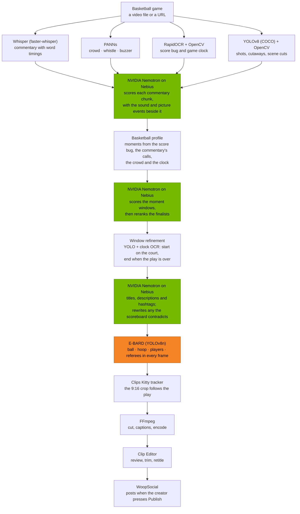

<div align="center">

# Clips Kitty — Basketball Highlights with NVIDIA Nemotron

**Turn a basketball game into vertical highlight clips. NVIDIA Nemotron on Nebius Token Factory picks the plays and writes the titles. E-BARD, YOLO, OpenCV and Whisper read the game.**

Nebius × NVIDIA Global AI Hackathon 2026 · Track: **Best Apps and Agents** · Licence: **AGPL-3.0**

[What changed](docs/hackathon/NEBIUS_CHANGES.md) · [Benchmarks](docs/hackathon/BENCHMARKS.md) · [Judge setup](docs/hackathon/JUDGE_SETUP.md) · [Demo script](docs/hackathon/DEMO_SCRIPT.md) · [Feedback](docs/hackathon/FEEDBACK.md)

<a href="https://youtu.be/g1dMqrq-YaI"></a>

</div>

This repository is the hackathon edition of **[Clips Kitty](https://github.com/ColinGPT9/clips-studio)**,
a free, open-source AI video clipper. It covers only what the hackathon adds:
NVIDIA Nemotron, served by Nebius Token Factory, as the language model of the
**Sports → Basketball** pipeline. Everything else about the app is documented in
the original repository.

## What it does

You give it a basketball game, as a file or a URL. It:

1. **Reads the game:** the commentary (Whisper), the crowd, whistle and buzzer
   (PANNs), the score bug and game clock (RapidOCR), and the shots and cutaways
   (YOLO and OpenCV).
2. **Asks Nemotron which plays are worth posting.** Nemotron scores the
   commentary with the sound and picture events beside it, scores the moments
   the basketball profile proposes, and reranks the finalists.
3. **Writes the titles with Nemotron**, then checks each one against the
   scoreboard. A title that names the wrong play or scorer is written again.
4. **Cuts each play to 9:16.** E-BARD finds the ball, hoop, players and
   referees in every frame, and the crop follows the play. Captions come from
   Whisper's word timings.
5. Leaves the clips in the **Clip Editor** for review. **WoopSocial** posts
   them only when the creator presses Publish.

The language model is called on the creator's own Nebius key, with no server in
between. One game cost under a cent (see [Results](#results)).

## What's new for the hackathon

- **A Nebius Token Factory provider** (`llm/providers/nebius.py`). Settings → AI
  lists it beside the other providers, with its live model list and prices.
  **Nemotron 3.5 Lightning** is preferred when Nebius offers it.
- **Nemotron answers without thinking.** With thinking on, it spent its whole
  8,192-token output limit reasoning on the first chunk of a game, and the job
  failed. The provider now asks for `enable_thinking: false`.
- **Reasoning-model handling and usage reporting** in the shared
  OpenAI-compatible adapter: thinking written into the answer is removed before
  the JSON is read, and every job logs the tokens the provider billed.
- **A frozen-evidence benchmark** (`scripts/hackathon/llm_bench.py`). It saves
  everything the pipeline knows about a game when the language model is first
  asked, so other models can be replayed on the same evidence.
- **A one-call check** (`scripts/hackathon/nebius_check.py`) that makes a real
  Basketball request the app's way, on your key.

Nothing was trained, fine-tuned or replaced. Every changed file is listed in
[NEBIUS_CHANGES.md](docs/hackathon/NEBIUS_CHANGES.md).

## Architecture



| Component | Role | Changed for the hackathon? |
|---|---|---|
| **NVIDIA Nemotron** (3.5 Lightning) | Scores commentary chunks and moment windows, reranks the finalists, writes titles and descriptions, and rewrites titles the scoreboard contradicts | **New backend.** Same prompts, schemas and parsers as before |
| **Nebius Token Factory** | Hosts Nemotron behind an OpenAI-compatible API, called directly on the creator's key | **New provider** |
| **[E-BARD](https://github.com/GabrieleGiudic/E-BARD)** | A YOLOv8n detector for basketball broadcasts: the ball, hoop, players and referees, for the 9:16 framing. Used unmodified under CC BY 4.0 | No |
| **YOLOv8** (Ultralytics, COCO) | Shot types, cutaways to the crowd and bench, close-ups, where clips start | No |
| **OpenCV** | Frame decoding, motion and cut signals, camera pan | No |
| **Whisper** (faster-whisper) | Transcript, word timings, captions | No |
| **PANNs**, **RapidOCR** | Crowd, whistle and buzzer; the score bug and game clock | No |
| **FFmpeg** | Cutting, captions, crop and encoding | No |
| **WoopSocial** | Posting to the creator's connected accounts | No |

**What Nemotron sees.** The same evidence the app's default model always got,
through the same prompts: the Whisper transcript chunk by chunk, the events
beside it (crowd and buzzer sounds, audio spikes, motion, scene cuts), the
windows the basketball moments proposed, and, for titles, each clip's
score-bug note (who scored, the score, the quarter and clock). No cloud model is
sent the picture.

**Why it stays modular.** The Basketball code never names a provider or model.
A job gets whatever backend `llm.backend` names, through one interface
(`llm/base.py`), so the next model is a configuration change, not a
computer-vision rebuild.

## Results

### A 2026 NBA game, end to end on Nemotron

Run on 28 October 2026: Toronto Raptors at Washington Wizards, a 43-minute
extended-highlights broadcast with a score bug. The footage and clips are not in
this repository, only the measurements.

| | |
|---|---|
| Model | `nvidia/Nemotron-3_5-Lightning` on Nebius, thinking off |
| Machine | Windows PC, RTX 3060 12 GB (Whisper `large-v3-turbo` on CUDA, NVENC encoding) |
| Whole job, from the file to rendered clips | **30.1 minutes**, 62 clips at 1080×1920 |
| Nemotron calls | 43, every answer usable JSON |
| Tokens and cost | 65,834 in, 19,537 out: **about $0.009** for the game |
| Nemotron's own time | about 90 seconds of the job (measured on a replay of the same evidence) |
| E-BARD framing | 49 clips tracked, 12 assisted, 1 uncertain |
| Titles | The scoreboard check caught 37 of 57 titles naming the wrong play or scorer: 23 were written again, 14 were written from the scoreboard |

**What Nemotron did worse.** Many titles needed the scoreboard check, and one
wrong title still got through ("Bulls's Three Puts the Raptors Up 7", in a
Wizards game). Titles written from the scoreboard are accurate but plain, such
as "Wizards trail by 4". The first attempt, with thinking on, failed outright
(see [What's new](#whats-new-for-the-hackathon)).

### Gemma and Nemotron on the same evidence

The benchmark freezes one game's evidence and replays only the language-model
steps per model, so the model is the only variable. It uses a public-domain 1995
high-school game.

| Run | Must-have plays found | Titles right | Language-model time | Cost |
|---|---|---|---|---|
| Gemma (`gemma:7b`, local, 4-core CPU), app run | 2 of 7 | 2 of 6 | about 60 min | none (local) |
| Gemma, replay on the same evidence | 2 of 7 | 1 of 7, 2 partly | 56.8 min | none (local) |
| Nemotron 3.5 Lightning (Nebius), replay | not run yet | | | |

Method, reference plays and every clip are in
**[docs/hackathon/BENCHMARKS.md](docs/hackathon/BENCHMARKS.md)**.

## Quick start

The full, tested steps are in **[docs/hackathon/JUDGE_SETUP.md](docs/hackathon/JUDGE_SETUP.md)**.
You need Python 3.11, FFmpeg, and a Nebius Token Factory API key from
<https://tokenfactory.nebius.com/project/api-keys>.

```bash
git clone https://github.com/ColinGPT9/clips-kitty-nebius-basketball
cd clips-kitty-nebius-basketball
pip install -r requirements.txt
python scripts/fetch_basketball_model.py && python scripts/fetch_panns.py
export NEBIUS_API_KEY=...                   # Windows PowerShell: $env:NEBIUS_API_KEY="..."
python scripts/hackathon/nebius_check.py    # one real Nemotron call, made the app's way
cd ui && npm install && npm run dev         # the desktop app
```

In the app:

1. Open **Settings → AI → Direct provider API → Nebius Token Factory**.
2. Paste the key, choose **Nemotron 3.5 Lightning** and press **Test connection**.
3. Go to **Add videos → Sports → Basketball**, add a game, and press **▶ Start queue**.

Use footage you have the rights to. The benchmark uses a public-domain 1995
game from the Internet Archive.

**Replaying a game with another model.** Run the engine through the benchmark
once, and the game's evidence is saved. Any model can then be replayed on it in
minutes, without processing the video again:

```bash
python scripts/hackathon/llm_bench.py serve --freeze bench/frozen -- --port 8765
python scripts/hackathon/llm_bench.py replay bench/frozen/<video>.pkl \
    --backend nebius/nvidia/Nemotron-3_5-Lightning --label nemotron --out bench/runs
python scripts/hackathon/llm_bench.py compare bench/runs/*.json
```

## Where the hackathon code is

| Path | What |
|---|---|
| [`llm/providers/nebius.py`](llm/providers/nebius.py) | The Nebius provider: endpoint, live model list and prices, Nemotron preferred, thinking off |
| [`llm/providers/adapters/chat_completions.py`](llm/providers/adapters/chat_completions.py) | The shared OpenAI-compatible adapter: thinking removed from answers, usage recorded |
| [`llm/providers/usage.py`](llm/providers/usage.py) | Adds up the tokens each model was billed for (counts only, never prompts or keys) |
| [`scripts/hackathon/llm_bench.py`](scripts/hackathon/llm_bench.py) | The frozen-evidence benchmark: `serve`, `replay`, `compare` |
| [`scripts/hackathon/nebius_check.py`](scripts/hackathon/nebius_check.py) | One real Nemotron request through the app's own code |
| [`tests/test_nebius.py`](tests/test_nebius.py) | Offline tests: every documented Nebius error, rate limits, thinking, usage |
| [`sports/basketball/`](sports/basketball/) | The Basketball pipeline Nemotron serves (unchanged) |
| [`docs/hackathon/`](docs/hackathon/) | Changes, benchmarks, judge setup, demo script, feedback |

## New versus existing work

Clips Kitty started in June 2026. During the hackathon's submission period
(from 2026-08-26), Colin built most of what this entry demonstrates:

- **2026-09-25:** cloud AI on the user's own key, with OpenRouter, OpenAI, Gemini,
  Claude, xAI and Meta.
- **2026-09-30:** the Sports framework.
- **2026-10-05 to 2026-10-21:** Basketball, including the E-BARD 9:16 crop
  (#151, #156) and release 2.1.0 (#168).

331 of the 752 commits up to `34f0c23`, where this edition starts, were made
inside the submission period. The WoopSocial publisher, the Clip Editor, Whisper
and the YOLO and OpenCV work predate it or were built alongside.

**New in this hackathon edition**, 2026-10-28 onward: the Nebius provider,
Nemotron with thinking off, the reasoning-model handling and usage reporting in
the shared adapter, the benchmark harness and the check script, the guards that
stop this copy publishing over the original's image or website, and this
documentation.

## Future development

The language model sits behind one interface, and a provider is one entry in a
catalogue (`llm/providers/catalog.py`). Next is Meta's models for the Meta
Global AI Developer Hackathon: the catalogue already has Meta's own API (Muse
Spark), and Nebius lists `meta-models/muse-spark-open` on the same key. No
Meta-specific work was done here.

## Licensing

AGPL-3.0, as the original, in [LICENSE](LICENSE). Copyright (C) 2026 ColinGPT9,
as in [NOTICE](NOTICE). Third-party components and model weights keep their own
licences, listed in NOTICE:

- the [E-BARD](https://github.com/GabrieleGiudic/E-BARD) weights are CC BY 4.0, used unmodified;
- Ultralytics YOLOv8 is AGPL-3.0;
- faster-whisper and the Whisper weights are MIT.

Nemotron is called as a hosted API on Nebius, and no model weights are
distributed here. Nebius lists Nemotron 3.5 Lightning under OpenMDW-1.1.
